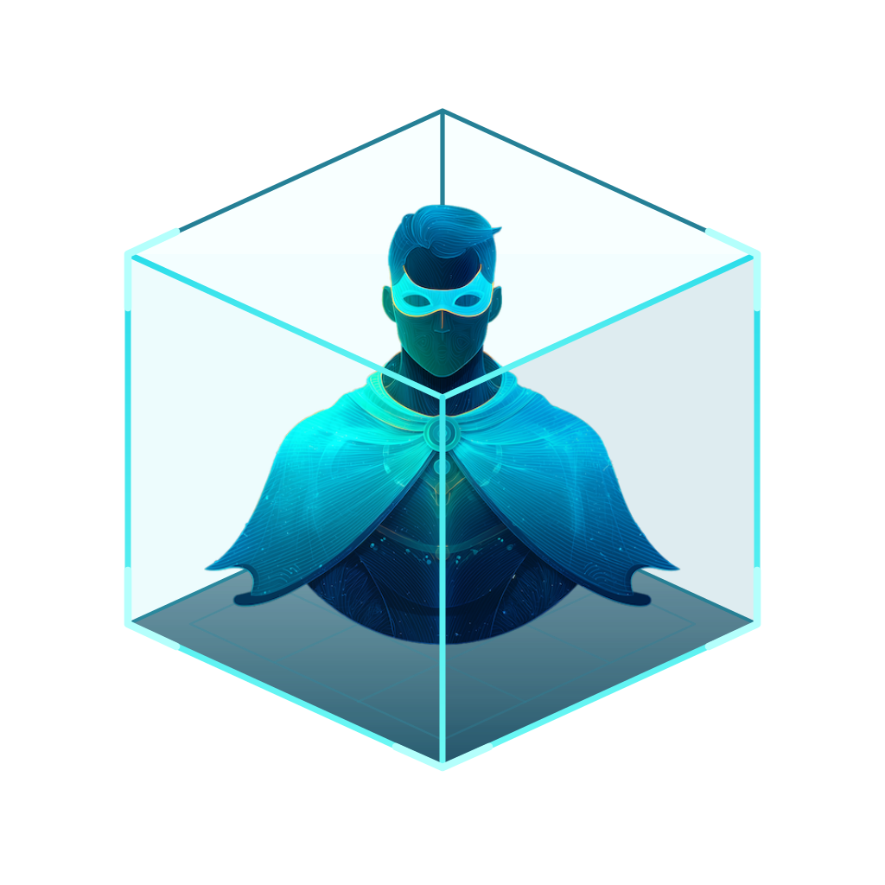

<p align="center">
  
</p>

<h1 align="center">CAIPE Sandbox</h1>

<p align="center">Configurable cloud environments for engineers and their AI agents.</p>

<p align="center">
  <a href="docs/content/getting-started.md">Get started</a> ·
  <a href="docs/content/architecture.mdx">Architecture</a> ·
  <a href="docs/content/security.md">Security</a> ·
  <a href="CONTRIBUTING.md">Contribute</a>
</p>

CAIPE Sandbox gives platform teams a way to offer persistent, isolated
environments on Kubernetes. Developers choose a profile, connect through a
browser terminal and run their agents with their own tools and credentials.
Platform teams manage access, resources, workload configuration and isolation.

Agents can do useful engineering work when they have a shell, compilers and
development tools. Giving them that access on a laptop or shared machine also
puts files, credentials and other workloads at risk. CAIPE Sandbox moves that
execution into managed cloud environments, with Kata micro VM isolation and
optional OpenShell process and network policies. Ordinary container deployments
are also supported for development and testing; their isolation differs from
micro VMs.

## What you can do

- **Offer environments through profiles.** Configure workload images, startup
  scripts, services, helpers and resource choices without hardcoding a single
  agent product into the portal.
- **Connect and work.** Open browser terminals, run sign-in helpers and use tool
  credentials inside the sandbox.
- **Keep files across suspend and resume.** Retain data on persistent volumes
  while stopping compute; suspension does not checkpoint process memory.
- **Control access and resources.** Configure SSO, ownership, namespace sharing,
  per-engineer sandbox limits and resource bounds.
- **Choose your platform integrations.** Use Agent Sandbox for Kubernetes
  lifecycle management, Kata for micro VM isolation, and OpenShell for runtime
  policy where required. The selected runtime and platform controls determine
  the protections; see the [security guide](docs/content/security.md).

## Deploy on Kubernetes

Start with the [operator quickstart](docs/content/getting-started.md). The main
Helm chart can install the portal and optional integration subcharts in one
release, or connect to services already installed in the cluster.

You provide Kubernetes 1.30+, persistent storage, identity, HTTPS access and an
enforcing CNI with appropriate platform policies. SQLite is bundled for a single
portal replica; multiple replicas use an external PostgreSQL database.

Agent Sandbox, OpenShell, Kata and Omnigent installation toggles default **off**.
Both current sandbox backends need the Agent Sandbox controller and CRDs, installed
through its optional subchart or provided by the operator. Kata is optional;
select it when workloads require a separate guest kernel.

See the [requirements and optional components](docs/content/getting-started.md#requirements-and-optional-components)
and [install/upgrade guide](docs/content/packaging.md) before configuring a deployment.

## Try the portal UI locally

Recommended toolchain: Python 3.12, uv 0.12.17+, Node.js 24 and npm 11.11+.
From the repository root:

```sh
make preview
```

Open <http://127.0.0.1:4193/agent-sandbox-portal/>. Create a sandbox, try
**Actions → Network & security**, inspect its configuration and open a terminal.
The preview uses fake identities and resources, needs no SSO or Kubernetes
credentials, and simulates terminal output. Keep it on loopback.

## Documentation

| Guide                                                                                   | What it covers                                                                         |
| --------------------------------------------------------------------------------------- | -------------------------------------------------------------------------------------- |
| [Overview](docs/content/overview.md)                                                    | Motivation and responsibilities of developers and platform teams.                      |
| [Profiles](docs/content/profiles.md)                                                    | Workload presets, customization and configuration ownership.                           |
| [Configuration](docs/content/profile-fields.mdx)                                        | Profile fields, with links to Helm values, environment variables and a worked example. |
| [Architecture](docs/content/architecture.mdx) and [code map](docs/content/code-map.mdx) | Interactive views of components, data flow and source responsibilities.                |
| [Database and persistence](docs/content/metadata.md)                                    | Stored state, reconciliation, migrations, backups and restore.                         |
| [Deployment checks](docs/content/deployment.md) and [scaling](docs/content/scaling.md)  | Acceptance, troubleshooting, observability, limits and terminal recovery.              |

Run the documentation site locally using the [docs instructions](docs/README.md).
The main branch publishes to GitHub Pages; the workflow's deployment result and
repository **Settings → Pages** show the site's URL.

## Repository layout

| Path                                        | Purpose                                                                          |
| ------------------------------------------- | -------------------------------------------------------------------------------- |
| `apps/portal/`                              | Python API, browser UI, integrations, Dockerfile, metadata migrations and tests. |
| `sandbox-images/common-tools/`              | Shared startup scripts and supervised-service support for workload images.       |
| `sandbox-images/default/`                   | Default workload image; organizations can supply their own private images.       |
| `charts/caipe-sandbox/`                     | Main Helm chart and optional integration dependencies.                           |
| `charts/agent-sandbox/`, `charts/omnigent/` | Application subchart sources; OpenShell and Kata use upstream charts.            |
| `docs/`                                     | Operator guides, configuration references and interactive architecture diagrams. |

## Contribute

Read [CONTRIBUTING.md](CONTRIBUTING.md) for local checks, image customization,
integration boundaries, dependency policy and releases. Run `make test` and
`make docs` before committing.

Licensed under [Apache 2.0](LICENSE).
