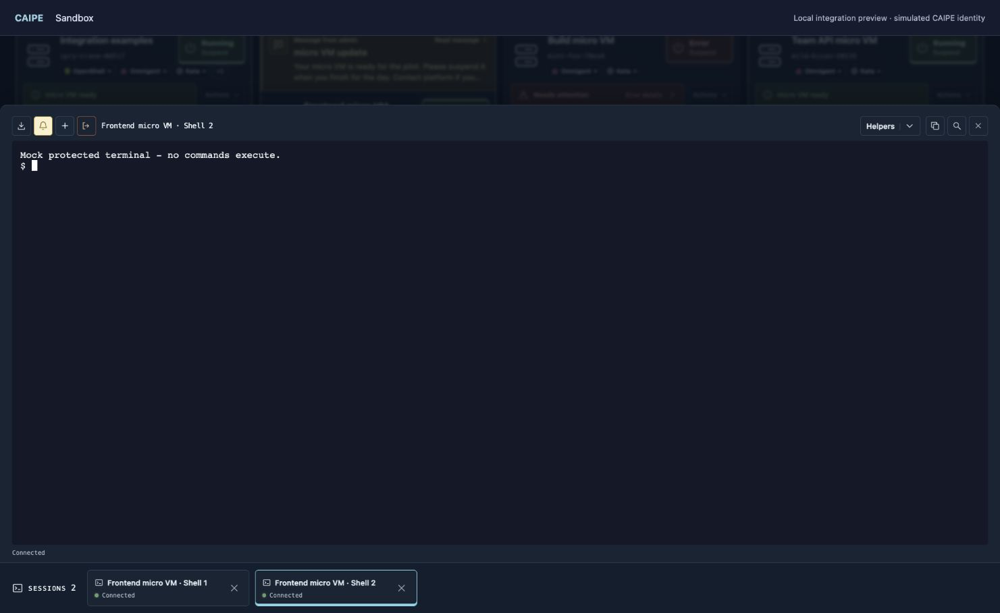

CAIPE's hosted-app proxy forwards the portal's pages and HTTP APIs, adding its
signed app JWT to each request. Sandbox verifies the JWT and uses its email as the
existing ownership identity. Sandbox continues to enforce roles, ownership,
namespace sharing, quotas and security controls. Standalone installations can keep
using OIDC.

Local preview using a simulated CAIPE identity and mocked workloads.

## Configure the two applications

Use the [Sandbox values overlay](https://github.com/caipe-io/caipe-sandbox/blob/main/apps/portal/examples/caipe-iframe.values.yaml)
with your normal image, profile, runtime and database values. Register the
[app catalog entry](https://github.com/caipe-io/caipe-sandbox/blob/main/apps/portal/examples/caipe-app.yaml)
in CAIPE. This uses the existing `proxied-next-zone` runtime with `chrome: iframe`;
it requires no CAIPE source change.

| Setting                                            | Purpose                                                                                                                                    |
| -------------------------------------------------- | ------------------------------------------------------------------------------------------------------------------------------------------ |
| `settings.origin`                                  | Browser-facing CAIPE origin, such as `https://caipe.example.com`. Used for write and terminal Origin checks.                               |
| `settings.basePath`                                | `/apps/sandbox`; matches the catalog mount path. Set `preserveMountPath: true`; do not strip this prefix.                                  |
| Catalog `runtime.origin`                           | The reachable Sandbox Service URL, including its port. CAIPE forwards HTTP here.                                                           |
| `auth.mode: caipe`                                 | Require the signed CAIPE hosted-app JWT on every authenticated HTTP request.                                                               |
| `auth.caipe.existingSecret` / `verificationKeyKey` | Existing Secret containing CAIPE's `AGENTIC_APP_TOKEN_SECRET`. The value must match CAIPE and contain at least 32 bytes after trimming.    |
| `auth.caipe.issuer` / `app_id`                     | Match CAIPE's issuer and catalog ID. Expected audience is `agentic-app:<app_id>`.                                                          |
| `auth.existingSecret` / `sessionSecretKey`         | A separate random Sandbox signing key of at least 32 bytes, shared by portal replicas. Never reuse the CAIPE key.                          |
| `auth.caipe.default_role` / `auth.adminEmails`     | Sandbox's user/viewer default and operator-managed admin list. CAIPE roles and unsigned identity headers do not grant Sandbox permissions. |
| `settings.terminalUrl`                             | Direct WebSocket base URL, including the portal prefix, without a trailing slash.                                                          |

Enable CAIPE's app catalog with `AGENTIC_APPS_INSTALL_ENABLED=true` and
`AGENTIC_APPS_CONFIG_PATH` pointing to the catalog file. Allow the app in CAIPE's
existing launch controls. The catalog's single `sandbox:access` scope allows
forwarding; Sandbox business permissions are still checked inside Sandbox.

CAIPE must provide signed `sub` and `email` claims. The adapter pins HS256 and
validates signature, issuer, audience, app ID and timestamps. Secret delivery and
TLS are operator responsibilities. CAIPE currently uses a shared HMAC signing key:
only give that key to trusted applications, since a verifier holding it can also
sign tokens.

## Terminal connections

CAIPE's HTTP proxy does not upgrade WebSockets. The iframe first requests a
terminal credential through the authenticated HTTP proxy. Sandbox checks shell
access and returns a signed credential valid for **30 seconds**, bound to the
micro VM's native identity, requested helper and normal/admin route.

The browser opens a direct WebSocket through ingress and sends the credential as
its first message. Sandbox rechecks current access before attaching a shell and
periodically while connected. Input is disabled until the server confirms the
shell is ready. Credentials never appear in query strings. Reconnects obtain new
credentials; terminal commands and interrupted helpers are not replayed.

Either use a dedicated Sandbox hostname, as in the overlay, or route the terminal
paths directly to the Sandbox Service on the CAIPE hostname. For same-host
routing, forward only `/apps/sandbox/api/sandboxes/<id>/terminal` and
`/apps/sandbox/api/admin/sandboxes/<id>/terminal` to Sandbox; leave the
`terminal-credentials` HTTP endpoints behind CAIPE. Use your ingress controller's
supported path matching, TLS and WebSocket idle timeout settings. No path rewrite
is needed. `extraObjects` can carry controller-specific ingress resources.

The direct endpoint requires the configured CAIPE Origin and a valid Sandbox
credential. It does not trust a browser cookie or `X-Caipe-*` header. Ordinary HTTP
API calls to the direct hostname still require a valid CAIPE JWT. This avoids a
second SSO flow and works with multiple portal replicas sharing the Sandbox key.

`auth.caipe.session_seconds` bounds an established terminal's authorization window
(one hour by default; eight hours in the example). It is separate from CAIPE's
five-minute HTTP JWT and the 30-second credential redemption window. Each HTTP
request and reconnect requires current CAIPE authentication. Existing sockets
recheck Sandbox permissions and expire at the Sandbox session limit; this does
not provide immediate CAIPE-wide logout revocation. Closing the iframe closes its
connections. Key rotation requires coordinated replicas and reconnects.

## Verify an installation

1. Launch Sandbox from CAIPE. Its inventory loads inside the iframe without a
   second login, repeated app branding or account controls.
2. Create a disposable micro VM, open two shells, run a command and resize the
   drawer. The terminal remains inside CAIPE while its socket uses direct ingress.
3. Run a helper, confirm its completion returns to an ordinary shell, and reconnect
   a dropped socket. Commands must not be repeated.
4. Check user/viewer/admin permissions, namespace sharing and the creation limit.
   An unsigned identity header or access to another micro VM must grant no access.
5. Confirm expired credentials, an unavailable ingress and an expired CAIPE session
   show a recoverable error. Exercise the configured base path, assets, modals and
   admin routes before inviting users.
