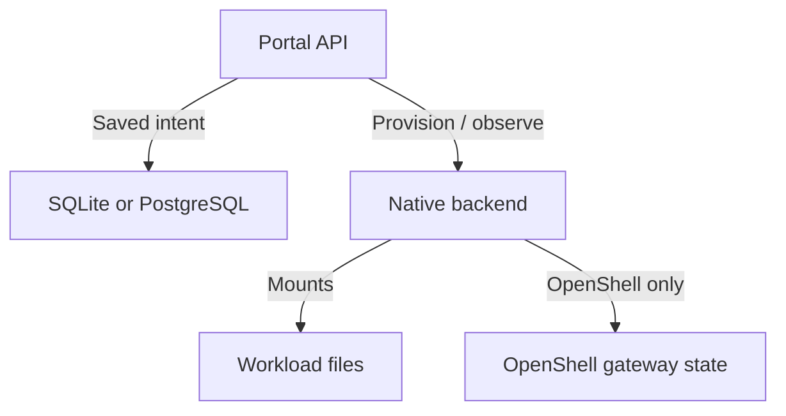

The portal database records **what should exist and who may use it**. Runtime
integrations report what actually exists. Files, login caches and application
state inside a micro VM live on its workload storage, not in the portal database.

## Where state lives

| State                                                                               | Owner                              | What must be retained                                                                      |
| ----------------------------------------------------------------------------------- | ---------------------------------- | ------------------------------------------------------------------------------------------ |
| Sandbox IDs, creators, namespace membership, grants and intended native manifests   | Portal SQLite/PostgreSQL database  | Database backup and matching portal/schema version.                                        |
| Applied profile snapshot and accepted configuration/policy overrides                | Portal database                    | Saved record, not just today's profile catalog.                                            |
| Pending operations, creation request IDs, resource reservations and leases          | Portal database                    | Coordination/recovery state; this is not a complete audit history.                         |
| Administrative restrictions, announcements and managed namespace policy definitions | Portal database                    | Control records and their revisions.                                                       |
| Current Sandbox/Pod identity, readiness and active native policy                    | Kubernetes / selected runtime      | Native resources and backend state. Status is observed, not copied into SQL on every poll. |
| OpenShell gateway's own native records and keys, when used                          | OpenShell-owned persistent storage | Back up through its own supported mechanism; a portal DB dump does not include it.         |
| Project files, CLI credentials and guest startup/service definitions                | Workload persistent mounts         | Volume backups/snapshots and the storage provider's recovery procedure.                    |
| Offered profile catalog, deployment settings and referenced Secrets                 | Operator deployment/secret systems | Configuration history and separately protected secret recovery.                            |

### State boundaries

An owner email, a portal UUID, a namespace and a native Kubernetes UID are
different identities. The namespace belongs to its first sandbox creator; later
VMs retain their own creators. Namespace-wide sharing does not transfer VM
ownership. See [Saved state and IDs](saved-state.mdx) for the field reference.

## SQLite or PostgreSQL

Both use the same `MetadataStore` interface and SQLAlchemy-based
`SQLMetadataStore`; there are not two separate application data models.

|                         | SQLite                                                                                | PostgreSQL                                                                                                                            |
| ----------------------- | ------------------------------------------------------------------------------------- | ------------------------------------------------------------------------------------------------------------------------------------- |
| Backing store           | File on the portal metadata PVC.                                                      | An operator-provided database service.                                                                                                |
| Portal replicas         | Exactly one, with one application worker.                                             | Multiple Pods supported; one application worker per Pod.                                                                              |
| Upgrade strategy        | Recreate.                                                                             | Recreate for schema changes; RollingUpdate only with an unchanged schema.                                                             |
| Helm input              | `database.url` under `/var/lib/portal/`; PVC size/class under `database.persistence`. | Clear `database.url`; supply `database.existingSecret` and `secretKey` for the connection URL. Optional `caSecret` supplies a TLS CA. |
| What the chart installs | Metadata PVC, retained with Helm/Argo keep annotations.                               | Connection wiring only; no PostgreSQL server or operator.                                                                             |

Use a **dedicated database for each independent portal deployment**. It can be
hosted on a shared PostgreSQL instance. Replicas of the same portal share that
database and session/identity configuration. Do not point unrelated portals at
the same tables and assume their inventories or global controls are isolated.

Connections are bounded and database failures are surfaced as unavailable/conflict
responses rather than leaking connection URLs. Inspect [Helm chart values](helm-values.mdx)
for configuration; changing a URL selects a database, it does not copy data into it.

## Schema and stored records

The schema lives in `apps/portal/portal/storage/schema.py`. Versioned DDL lives in
`storage/migrations/versions/`; Alembic records the installed revision in
`alembic_version`.

| Table               | Purpose                                                                                                                                             |
| ------------------- | --------------------------------------------------------------------------------------------------------------------------------------------------- |
| `sandboxes`         | Identity, owner/scope, applied profile, intended manifest, native binding, requested mode, accounting, pending operation, revisions and timestamps. |
| `scope_grants`      | Namespace-scoped view/shell grants, separate from VM ownership.                                                                                     |
| `creation_requests` | Creator/request-ID association and input fingerprint, so a repeated creation can resolve to the original allocation.                                |
| `portal_controls`   | Global and per-user restrictions, announcements and namespace controls/policy definitions.                                                          |
| `portal_leases`     | Renewable ownership of operation and maintenance work across portal replicas.                                                                       |

The pending operation is JSON on the sandbox row, not a separate append-only
history table. Completion clears it; retirement sets `deleted_at`. Keep action
logs separately when you need audit retention. The database does not store shell
process memory, terminal transcripts or the contents of workload volumes.

## A lifecycle action crosses two systems

1. **Reserve in SQL:** validate access/resources and save intent plus a pending
   operation. Creation reservations participate in creator limits and quotas.
2. **Call the backend:** acquire/renew the operation lease, check native identity,
   then observe or perform the requested action.
3. **Confirm in SQL:** save the confirmed native binding or outcome using revision
   and lease checks, then clear the pending operation.
4. **Recover uncertainty:** if a response is lost or delayed, retain the pending
   action and inspect native effects before retrying. A conflicting or replaced
   native identity needs investigation.

SQL transactions and leases coordinate the portal's replicas. They do not create
a distributed transaction with Kubernetes/OpenShell or make every native call
exactly-once. Do not clear journal entries or repeat mutations merely because an
HTTP request timed out. Existing workloads may continue running while the portal
or database is unavailable; management and revalidated access still depend on the
control plane.

## Drift and reconciliation

The saved manifest describes accepted intent, including supported user policy
edits. A change to the offered catalog is not automatically applied to existing
sandboxes.

| Mechanism                   | Current behavior                                                                                                                                                                 |
| --------------------------- | -------------------------------------------------------------------------------------------------------------------------------------------------------------------------------- |
| Status/refresh              | Observes native identity, readiness and configuration. Refresh does not adopt arbitrary native edits into the database.                                                          |
| Periodic configuration sync | Default interval is 30 seconds; `settings.reconcileIntervalSeconds: 0` disables it. Replicas coordinate through shared leases.                                                   |
| Direct Agent Sandbox        | Checks the bound, existing Sandbox CR and conditionally patches supported saved spec/metadata. Its controller manages the underlying Pods/claims.                                |
| OpenShell                   | Exposes native drift, identity checks and policy operations. It currently has no general `reconcile` method, so periodic/manual configuration sync is not universally available. |
| Manual sync                 | **Actions → View/Sync Configuration** offers a reviewed, authorized sync where supported. Native UID, saved revision and pending-operation checks prevent blind overwrite.       |
| Administrative maintenance  | A separate loop retries supported access enforcement and eligible namespace cleanup, with a ten-second delay, when configured.                                                   |

Automatic sync skips pending/unbound allocations and does not silently adopt a
replacement native object. A deleted Sandbox CR or changed UID is not an invitation
to recreate/adopt arbitrary resources from the database. Investigate provider
state and use the supported recovery path. Reconciliation failures are logged;
they do not mean SQL and native state have become consistent.

## Schema upgrades and replicas

Normal portal startup **checks** the schema. Migration is an explicit command
selected by the chart's per-Pod `metadata-schema` init container:

| Deployment strategy | Init command                                                    | Safety boundary                                                                                                                                                   |
| ------------------- | --------------------------------------------------------------- | ----------------------------------------------------------------------------------------------------------------------------------------------------------------- |
| `Recreate`          | `python -m portal.storage migrate`, followed by a schema check. | Kubernetes stops the old Deployment Pods before creating replacements. The migration lock serializes schema work.                                                 |
| `RollingUpdate`     | `python -m portal.storage check`.                               | PostgreSQL only, with exactly the expected schema. A mismatch fails initialization and tells the operator to use Recreate; it does not migrate under old writers. |

There is no separate migration Job. This works with a Helm-driven deployment,
without requiring Argo. New Pods may initialize concurrently; PostgreSQL's
advisory migration lock or SQLite's write transaction serializes database work,
not Pod creation. Waiting init containers can retry; compatible instances find
the current schema and continue.

**A migration lock does not block old application queries.** Stopping old writers
is the deployment/operator's job. Recreate covers that Deployment, not another
installation, script or process using the same database. Unknown/newer revisions
are refused; Recreate is not an automatic downgrade. A Helm rollback does not
reverse database migrations.

Take a backup and allow a maintenance window for schema changes. Portal shutdown
drains terminals for three minutes by default; workload Pods and volumes are
separate. A new terminal connection does not restore an old shell's process
memory. See [Scaling](scaling.md) for replica and connection behavior.

## Backup, restore and moving deployments

Back up each state owner from the first table. A SQL backup alone cannot restore
VM files, gateway keys, deployment settings or external tool credentials.

- **SQLite:** use a consistent database backup mechanism, or stop all writers
  before taking a cold copy. Do not assume copying a live file is sufficient.
  See SQLite's [online backup guidance](https://www.sqlite.org/backup.html).
- **PostgreSQL:** use the operator's supported backup process or a logical dump
  with a matching restore tool. Restore required roles/permissions as appropriate;
  a single-database dump is not a backup of every server-level object. See the
  [PostgreSQL dump/restore guide](https://www.postgresql.org/docs/current/backup-dump.html).
- **Workload/gateway storage:** use storage/runtime-supported snapshots or backups,
  preserve identity and retention information, and test attachment/read access.
  Account for writes occurring after the SQL backup; these stores are not one
  atomic snapshot.

A useful restore drill is:

1. Record the portal image/schema version, profile/deployment configuration and
   native provider/namespace identities with the backup. Protect credentials and
   backups using the platform's access and encryption controls.
2. Restore into a separate database/storage location. Do not give the test portal
   credentials that can reconcile or mutate the live cluster/gateway.
3. Run the version-matched `python -m portal.storage check` against the restored
   database. Verify inventory, manifests, grants and pending actions, and separately
   verify restored workload files and native gateway state.
4. For a real cutover, stop all portal writers and coordinate native lifecycle
   changes before switching the database. Review bindings and drift before
   resuming reconciliation or user actions.

A same-backend database move is different from a cluster/runtime move. Fresh
Kubernetes UIDs, namespaces or gateway identities cannot simply be relabeled as
the old allocations. Moving SQLite data to PostgreSQL also needs an explicit,
tested conversion procedure; there is no automatic cross-database data-copy
command in the portal. Changing connection settings does not perform that move.
