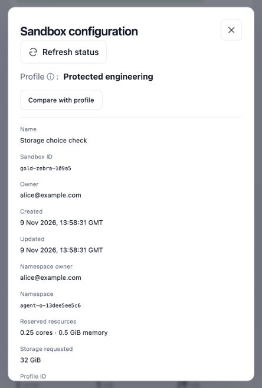

A profile is an operator-managed starting configuration for a sandbox: its
image, startup command, environment, persistent mounts, terminal and optional
helper scripts. Engineers select a profile when creating a micro VM.

**Profile defaults + permitted user choices + platform controls = effective sandbox configuration.**

The portal validates those inputs, saves the selected profile and resolved
configuration in its metadata database, and asks the selected backend to create
the workload. Browse [profile fields](profile-fields.mdx),
[Helm chart values](helm-values.mdx), [environment variables](environment-variables.mdx)
and [saved state and IDs](saved-state.mdx) for the full reference, or follow the
[worked example](configuration-example.mdx) to see how resource choices map to
native fields.

## Manage the catalog

Define `profiles` and `defaultProfile` in the chart's values. Profiles are managed
through deployment configuration or GitOps; the portal lets engineers select
them and lets administrators inspect their definitions. It does not provide a
live profile editor.

Each profile needs a unique `id`, a `title`, and **exactly one** backend section:
`agentSandbox` or `openShell`. Defining both is rejected. `defaultProfile` must
reference an entry in the catalog. Unknown top-level profile fields are rejected;
this is not an arbitrary Kubernetes manifest passthrough.

| Profile field                | What it configures                                                            | Who reads it                                                   |
| ---------------------------- | ----------------------------------------------------------------------------- | -------------------------------------------------------------- |
| `id`, `title`, `description` | Catalog identity and labels displayed in the portal.                          | Portal API and UI.                                             |
| `agentSandbox.spec`          | Native Agent Sandbox spec: image, command, mounts and supported Pod settings. | Portal renderer, then Agent Sandbox controller and Kubernetes. |
| `openShell.spec`             | Native OpenShell `SandboxSpec`: image, command and starting policy.           | OpenShell integration, gateway and sandbox runtime.            |
| `terminal.command`           | Command to execute when opening a terminal.                                   | Portal terminal connection.                                    |
| `helpers`                    | Buttons with a title, icon, shell script and optional status probe.           | Portal helper execution and status checks.                     |
| `ui.resources`               | Default, minimum and maximum CPU, memory and storage choices.                 | Portal forms **and API validation**.                           |

Gateway addresses, gateway credentials, namespace rules, storage class and
approved runtime classes belong to **deployment values**, not individual
profiles. For example, namespace configuration is the chart's top-level
`namespace` section; it is not a supported profile key. See
[packaging](packaging.md) for the installation settings.

## What engineers can change

| Setting                            | Portal behavior                                                                                                                                                                                                          |
| ---------------------------------- | ------------------------------------------------------------------------------------------------------------------------------------------------------------------------------------------------------------------------ |
| Display name and profile           | Chosen during creation; the default profile is preselected.                                                                                                                                                              |
| CPU and memory requests and limits | Chosen within profile and platform bounds. Direct Agent Sandbox supports later changes only when fully suspended and its Pod has stopped. OpenShell does not currently support resizing an existing micro VM.            |
| Persistent storage size            | Chosen at creation for direct Agent Sandbox and OpenShell's `persistentVolumeClaim` storage mode. OpenShell's default `gateway` mode uses the fixed `settings.openShell.storageGiB`, matching the gateway configuration. |
| Namespace                          | The platform decides whether engineers can reuse an accessible namespace. Namespace sharing applies to every sandbox in that namespace.                                                                                  |
| OpenShell policy                   | Creation controls allow supported filesystem/process settings. The owner or an administrator can edit supported network policy through **Network & security**; those saved edits override the starting profile policy.   |
| Kubernetes NetworkPolicy           | Read-only for engineers in **Network & security**; editing is restricted to platform administrators.                                                                                                                     |

The UI only offers capabilities supported by that backend. Selecting a profile
does not grant arbitrary image, runtime, mount or security overrides through
the API.

## Resource defaults and bounds

`ui.resources` uses Kubernetes quantities: for example `500m` CPU, `1Gi` memory
and `20Gi` storage. When supplied, it must contain all three sections:
`default`, `minimum` and `maximum`. Each section contains `requests`, `limits`
and `storage`; requests and limits each contain `cpu` and `memory`.

The default must fit the profile bounds, and the bounds must fit the deployment's
`resourcePolicy` envelope. The portal checks these when loading the catalog and
validates engineers' choices again on the API. If `ui.resources` is omitted,
supported native resource values and platform defaults supply the starting size;
platform validation still applies.

For direct Agent Sandbox, the current renderer requires one workload container
named `host` and one persistent claim named `home`. Initialization containers are
supported within the selected allocation; additional workload containers and
sidecar-style init containers are not supported. When using `ui.resources`, do
not also put CPU/memory defaults or claim storage sizing in `agentSandbox.spec`:
the renderer rejects that duplication and writes the selected values itself.

OpenShell maps CPU and memory to `openShell.spec.template.resources`. Disk
choices depend on the deployment's storage mode.

### OpenShell disk choices

To let engineers choose disk size at creation, configure:

```yaml
settings:
  storageClass: your-storage-class
  openShell:
    storageMode: persistentVolumeClaim
openShell:
  server:
    drivers:
      kubernetes:
        allowDriverConfig: true
        resourceAdmission:
          enabled: true
```

For an external gateway, configure the equivalent native settings there. Set
`ui.resources.default.storage`, `minimum.storage` and `maximum.storage` on each
profile, for example **20Gi**, **5Gi** and **100Gi**. CPU and memory sections
remain required. Platform resource bounds and quotas also apply; changing only
the form does not grant extra capacity.

The portal creates a `ReadWriteOnce` filesystem PVC in the sandbox's namespace,
then uses OpenShell's native `driver_config.kubernetes` attachment to mount it at
the profile's `openShell.spec.environment.HOME`. OpenShell reserves `/sandbox`
itself, so set `HOME` to a normalized child such as `/sandbox/home`. Configure
the terminal to start there, for example `["bash", "-lc", "cd \"$HOME\"; exec bash -i"]`.
The portal generates this attachment; arbitrary profile-supplied
`driver_config` remains rejected. The PVC is bound to the native Sandbox UID so
it survives suspend/resume and is garbage-collected when that Sandbox is deleted.
Uncertain creations retain their disk until recovery verifies the runtime outcome.

An explicit workspace mount replaces OpenShell's automatic workspace and its
image-copy initialization. The image's startup must initialize an empty writable
home directory; use `sandbox-start --seed-dir /path/in/image` when supplying initial
startup files. Do not depend on image files hidden underneath the mount.

The default `gateway` mode preserves the existing fixed-size behavior. Keep its
profile storage default equal to `settings.openShell.storageGiB` and the gateway's
workspace size. Changing mode or profile defaults affects new creations only:
existing sandboxes keep their disk attachment and size. Neither mode currently
offers disk expansion through the portal.

The selected amount appears as **Storage requested** in **View/Sync
Configuration**. It is the configured disk request, not current filesystem usage.



## What actually enforces the configuration?

| Layer                            | Responsibility                                                                                                                                 | Boundary                                                                                                                             |
| -------------------------------- | ---------------------------------------------------------------------------------------------------------------------------------------------- | ------------------------------------------------------------------------------------------------------------------------------------ |
| Portal API                       | Validates the catalog, access, allowed choices and supported native fields.                                                                    | Controls requests made through the portal; a UI restriction alone is not enforcement.                                                |
| Kubernetes and platform controls | Apply resource limits, service accounts, Pod security, admission and installed network controls. An approved RuntimeClass selects the runtime. | These settings live outside the guest. Kata supplies a VM isolation boundary only when installed and selected.                       |
| OpenShell, when selected         | Applies its supported filesystem, process and network policy.                                                                                  | Policy enforcement comes from the OpenShell runtime, not from the presence of a profile key. Kubernetes network controls also apply. |
| Programs inside the sandbox      | Run startup commands, terminal commands, services and helpers.                                                                                 | Users and agents can change files they have permission to write. A startup script is setup, not an immutable security policy.        |

For direct Agent Sandbox, the renderer also enforces a non-root security baseline,
disables automatic service-account token mounting and rejects unsupported host
access. Cluster admission and network enforcement must still be installed and
configured by the operator. A profile does not make ordinary Pods into micro VMs.

## Saved configuration and changes

Existing sandboxes retain their profile snapshot and saved effective configuration.
Editing or removing a catalog entry does not silently change their image,
startup commands or permissions. New allocations use the current catalog.

**View/Sync Configuration** shows the sandbox's saved configuration and comparison
with its profile. Refresh reads current state; sync reapplies supported saved
intent. It does not automatically adopt a newer catalog profile. Supported
OpenShell policy edits are retained as overrides rather than being reset to the
profile's starting policy.

## Images, helpers and credentials

Put reusable tools and the normal startup process in the workload image. A helper
defines a button and a command; it does not install the named tool or sign the
engineer in automatically. Status needs an explicit probe. Profiles can reference
image-provided startup tools and supported init containers; initialization should
tolerate retries.

Keep credentials out of profile text and helper scripts: profiles and saved
configuration are readable. Use tool-native login flows or platform-managed
Secret references. Mount persistent storage at the paths where tools actually
write their files and login state; setting a working directory alone does not
make that path persistent.
