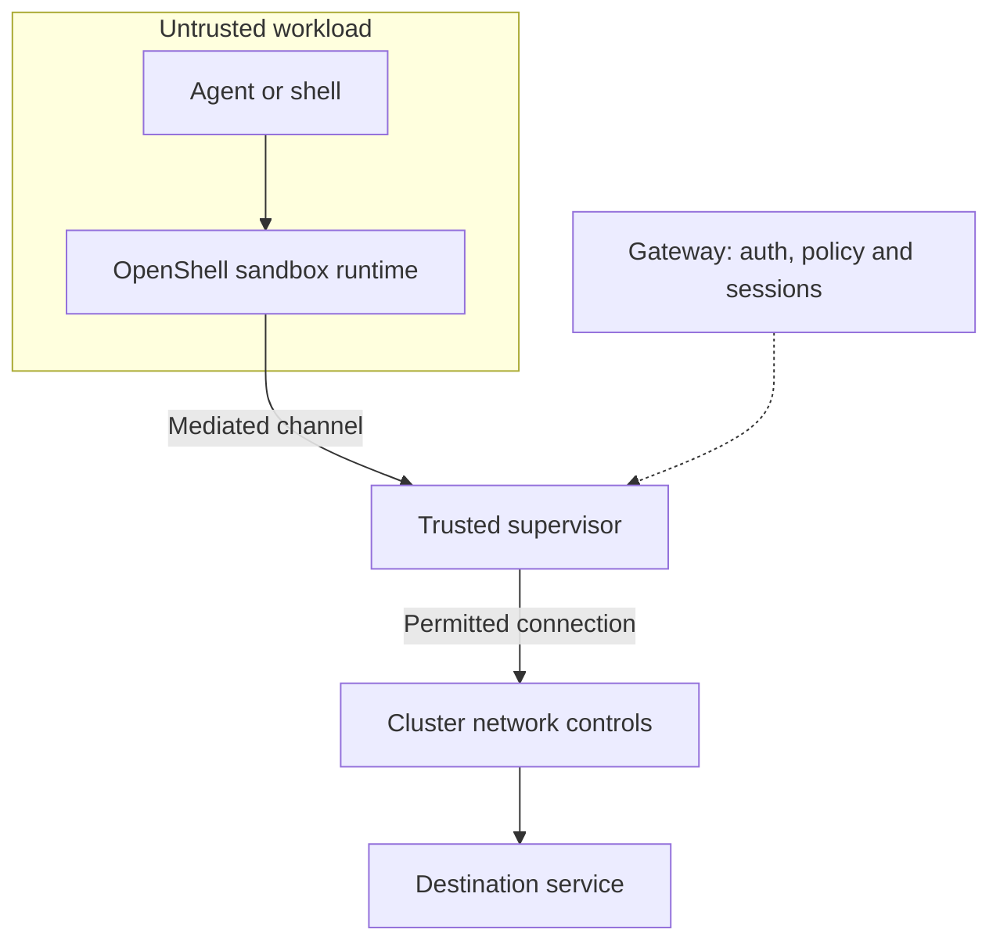

Treat commands, downloaded code and agent-generated actions as potentially
hostile. The goal is to contain mistakes and attacks, limit access to other
systems, and keep one engineer's environment separate from another's.

An authenticated engineer can run untrusted code. Authentication alone does not
make that code safe, and a profile alone does not provide containment. This guide
describes the checked-in implementation; operators must verify enforcement in
their own cluster.

## What each layer adds

| Layer or integration                | What it adds                                                                                                            | Its boundary                                                                                                                        |
| ----------------------------------- | ----------------------------------------------------------------------------------------------------------------------- | ----------------------------------------------------------------------------------------------------------------------------------- |
| **Portal API and sign-in**          | Authentication, roles, ownership, namespace sharing, resource validation and authorized terminal access.                | Controls portal requests. It does not constrain every command once a shell is open.                                                 |
| **Profiles**                        | Reviewed images, startup configuration, helpers, starting policies and permitted resource choices.                      | Configuration presets validated by the API. Writable guest files and scripts remain changeable.                                     |
| **Agent Sandbox**                   | Controller-managed Sandbox resources, Pods, persistent claims and lifecycle.                                            | Provisioning and reconciliation. Its name does not imply a VM boundary or an agent network policy.                                  |
| **Kubernetes**                      | Service accounts, scoped RBAC, admission, Pod security, resource limits and CNI-enforced network policies.              | Protects cluster resources and workload placement/access. A namespace alone does not isolate network traffic.                       |
| **Kata, when selected**             | A separate guest kernel and hardware-backed VM boundary for workload containers.                                        | Reduces host-kernel sharing. It does not decide which external APIs an agent may call.                                              |
| **OpenShell, when selected**        | Native filesystem/process controls and supervisor-mediated network policy, plus authenticated management and execution. | Enforces its supported policy and native isolation contract. It does not replace portal authorization or operator cluster controls. |
| **Workload image and common tools** | Installed tools, startup, service supervision and helper commands.                                                      | Operational setup. Supervisor service configuration and login helpers are not independent security boundaries.                      |
| **Omnigent, when enabled**          | An additional agent server/host connection and application authentication path.                                         | Adds a consumer and execution path, not another isolation layer. Its permissions and credentials need their own review.             |

Kata's [architecture](https://github.com/kata-containers/kata-containers/blob/main/docs/design/architecture/README.md)
describes its VM boundary. Select an installed, verified Kata RuntimeClass for
that protection; an arbitrary class name or a badge is not proof of isolation.
Ordinary container deployments share the node kernel and have a different threat
model. See [System architecture](architecture.mdx) for the component layout.

## Defaults are not a complete security posture

These are repository defaults, not the settings of a particular installation.

| Setting                           | Current behavior                                                                                                                                               | Operator decision                                                                                                                       |
| --------------------------------- | -------------------------------------------------------------------------------------------------------------------------------------------------------------- | --------------------------------------------------------------------------------------------------------------------------------------- |
| Integration installation          | Agent Sandbox, OpenShell, Kata and Omnigent subchart toggles are all off. Both current backends still require Agent Sandbox infrastructure.                    | Install or reuse the required components. Select the desired runtime separately.                                                        |
| Runtime approval                  | Empty `settings.runtimeClass` with no explicit approval is rejected. `[""]` explicitly permits the cluster's ordinary container runtime.                       | For workloads requiring VM isolation, approve only the reviewed installed VM runtime classes.                                           |
| Portal network baseline           | `namespacePolicy.baselineNetworkPolicy: false`.                                                                                                                | Supply operator policies, or deliberately enable and review the optional baseline. OpenShell's native fence is a separate prerequisite. |
| Optional direct-backend baseline  | When enabled, permits cluster DNS and, with the default `publicHttpsEgress: true`, broad public IPv4 TCP/443; selected private/link-local ranges are excluded. | This is not a domain allowlist. Narrow permissions to the actual task and test IPv4, IPv6, DNS and private-service paths.               |
| Sandbox count and namespace quota | `settings.maxSandboxesPerUser: 0` disables the count limit; namespace quota defaults to an empty object.                                                       | Set a cohort-appropriate count limit, resource envelope, namespace quota and cluster capacity budget.                                   |
| Sign-in and session               | Independent OIDC requires configured HTTPS identity/origin and Secret references. The default portal session is one hour.                                      | Limit admission to the intended users, explicitly seed admins and select an appropriate session lifetime.                               |

Use [Helm chart values](helm-values.mdx) to inspect exact inputs. Portal bootstrap
policies are create-only: changing their values does not automatically replace
policies in every existing namespace.

## Access, sharing and the trusted control plane

Human sign-in, cluster identity and tool sign-in are different identities:

- **Human:** OIDC claims, or a verified CAIPE hosted-app JWT, establish the email identity. Viewer/user roles can be
  mapped from approved groups; `auth.adminEmails` separately seeds administrators.
  The API derives the caller rather than trusting a browser-supplied owner.
- **Portal:** its Kubernetes ServiceAccount manages resources through scoped
  bindings and chart admission rules. Bootstrap permissions span namespaces;
  enabling seeded administrators also grants the chart's administrative sandbox
  read/modify/exec permissions. Treat the portal as a privileged control plane.
- **Workload:** uses its configured non-root filesystem identity and a separate
  ServiceAccount. Tool credentials come from their own login/provider flows.
  Portal sign-in does not sign the CLI in.

Keep the portal, database, gateway, controllers and their credentials outside
untrusted workloads. The portal chart runs its own application and schema init
container non-root, with a read-only root filesystem, dropped capabilities and
privilege escalation disabled. Those controls do not make a compromised control
plane harmless.

Sharing grants **view** or **shell** access to the namespace. It applies to every
sandbox in that namespace; it does not transfer each VM creator's lifecycle
ownership. Shell users generally share the workload's filesystem identity and
can access credentials that identity can read. Prefer a namespace per sandbox
unless the whole namespace is intentionally a shared trust group.

Terminals require authentication and an allowed origin, and access is rechecked
while connected. A signed portal session has its own lifetime: do not assume an
IdP group change or logout instantly invalidates an existing portal cookie. Use
the portal's administrative access controls for urgent access restriction and
verify terminal disconnection behavior.

## Workload enforcement

### Direct Agent Sandbox

The renderer validates the native profile and applies the configured non-root
UID/GID, `runAsNonRoot` and `RuntimeDefault` seccomp. It also:

- Uses the configured runner ServiceAccount with automatic token mounting off.
- Disables host network, PID and IPC namespaces.
- Rejects privileged mode and privilege escalation; drops Linux capabilities.
- Rejects host-path volumes and projected ServiceAccount tokens.
- Enforces approved runtime selection and supported resource budgets.

New managed namespaces carry the Kubernetes **restricted** Pod Security labels;
the chart also installs admission rules for its managed identities, bindings and
direct workload runtime/ServiceAccount. Inspect the installed policy bindings and
any cluster exemptions. The renderer protects portal submissions; native
admission protects the requests it actually matches. See the Kubernetes
[Pod Security Standards](https://kubernetes.io/docs/concepts/security/pod-security-standards/)
for the cluster baseline.

The workload root filesystem is not universally made read-only by this backend.
Its writable mounts, image contents and process permissions still matter.
Non-root execution does not stop an agent from deleting files it owns.

### OpenShell

OpenShell uses its own native provisioning/security contract. Do not assume the
direct backend's Pod template is applied unchanged to its trusted supervisor.
The [v0.1.6 architecture](https://docs.nvidia.com/openshell/v0.1.6/about/architecture)
places the untrusted workload and trusted supervisor on opposite sides of a
protected boundary:

The **supervisor** checks the network request and opens the permitted external
connection. The **gateway** manages policy, lifecycle and sessions; it is not the
hop through which every application connection must pass. Kubernetes/CNI must
enforce the native outer fence that prevents direct workload egress.

The portal uses gateway client TLS, checks native sandbox identity and policy
admission, and attaches terminals/helpers through the OpenShell connection. A
gateway failure does not trigger direct Kubernetes-exec fallback.

Apply the pinned upstream [security guidance](https://docs.nvidia.com/openshell/v0.1.6/security/best-practices):
verify kernel/runtime prerequisites, use enforced rather than audit-only request
rules for actual blocking, require needed Landlock restrictions, and keep writable
paths and allowed binaries/endpoints narrow. A permitted endpoint can still
receive data the agent is allowed to read. A read-only API preset is not a
general data-loss-prevention guarantee.

OpenShell provider-mediated credentials need explicit native configuration.
Selecting an OpenShell profile does not automatically hide credentials stored
by arbitrary CLI logins in the workload.

## Network policies and who may change them

| Control                                                    | Who manages it                                                                                | Important limit                                                                                                                       |
| ---------------------------------------------------------- | --------------------------------------------------------------------------------------------- | ------------------------------------------------------------------------------------------------------------------------------------- |
| Starting profile policy                                    | Profile administrator; supported OpenShell creation choices can be overridden by the creator. | A starting policy is not an immutable corporate ceiling.                                                                              |
| OpenShell live network policy                              | VM creator or platform administrator, when the native policy is editable.                     | Accepted edits override the starting profile and are preserved during sync.                                                           |
| OpenShell global policy                                    | Configured through the upstream administrative mechanism.                                     | The portal recognizes global-policy ownership and disables sandbox policy editing; it does not provide a global-policy management UI. |
| Kubernetes NetworkPolicy                                   | Platform administrator in **Network & security**, plus operator-managed policies.             | Engineers can inspect it. The portal editor changes supported egress on its managed policy, not arbitrary cluster security objects.   |
| Runtime, service accounts, admission and resource envelope | Platform deployment/cluster administrator.                                                    | Keep authority and credentials to alter these outside the workload.                                                                   |

Kubernetes NetworkPolicies combine **additively**: an extra deny-all policy does
not cancel a broad allow from another policy. They require an enforcing CNI and
operate at a different layer from OpenShell's request rules. Inspect every policy
selecting the workload **and supervisor**, including policies installed outside
the portal. See the Kubernetes
[network policy semantics](https://kubernetes.io/docs/concepts/services-networking/network-policies/).

For a mandatory organization boundary, use verified upstream global-policy
controls and/or operator-enforced network boundaries. Do not rely on an editable
profile default. Existing OpenShell support does not imply a general corporate
policy-inheritance engine in the portal. Envoy integration is currently deferred.

## Images, credentials, storage and audit

- **Images:** use reviewed digest-pinned images, scan both application and base
  packages, track vendor-dependent exceptions, and refresh nodes/runtime images
  as well as the portal. Profiles and helper names do not install missing tools.
- **Secrets:** keep gateway client keys, session-signing keys, database credentials
  and cluster credentials out of the guest. Keep secrets out of profile text and
  helper scripts: those definitions are readable and retained. Use narrowly
  scoped tool credentials and rotate/revoke them through the issuing service.
- **Persistent state:** a CLI login cache under persistent HOME survives
  suspension. Suspension stops compute; it does not erase data or revoke external
  tokens. Review volume retention/reclaim and offboarding behavior. Encrypt and
  restrict access to database/volume backups, and prove a restore separately.
- **Audit:** collect portal action logs and correlation IDs, Kubernetes audit/events
  and relevant gateway/supervisor policy decisions. Portal telemetry avoids
  recording terminal contents; it is not a full shell transcript or a tamper-proof
  audit archive. Configure collection, access and retention, and inspect tool or
  upstream output before sharing it.

See [Database and persistence](metadata.md) for backup and recovery boundaries,
and [Deployment](deployment.md) for operator-provided services.

## Verify before inviting users

Use disposable test sandboxes and controlled test endpoints. The presence of a
manifest, badge or healthy Pod is not the acceptance test.

| Check                        | Expected evidence                                                                                                                                                          |
| ---------------------------- | -------------------------------------------------------------------------------------------------------------------------------------------------------------------------- |
| Two-user authorization       | One user cannot read, change, delete or open a terminal on another user's private sandbox by substituting an ID.                                                           |
| Namespace sharing            | View cannot open shells; shell grants cover the intended namespace. Revocation blocks subsequent access and closes active sessions after revalidation.                     |
| Runtime and Pod baseline     | The actual workload uses the reviewed runtime and expected non-root/tokenless identity. Unsupported portal overrides and matching unsafe native Pod requests are rejected. |
| Cluster credential access    | The untrusted workload does not receive control-plane/gateway keys or an automatically mounted Kubernetes API token. Check every added mount and environment source.       |
| OpenShell isolation          | Approved requests succeed; prohibited direct connections fail even with proxy environment variables removed. Verify the runtime's fence and relevant IPv4/IPv6/DNS paths.  |
| Policy enforcement           | At a controlled endpoint, an allowed read succeeds and a prohibited test operation fails in enforce mode. Audit-only logging does not count as a denial.                   |
| Control-plane outage         | New protected execution fails safely when the gateway is unavailable; the portal does not bypass it with direct exec.                                                      |
| Resource abuse and retention | Allocation limits apply across namespaces, including suspended/unresolved creations. Test quota exhaustion, resume, deletion and retained-volume behavior.                 |

These checks complement an independent security assessment. They do not establish
that every image, runtime version or cluster configuration is safe.

## Implementation reference

| Concern                                              | Owning source                                                               |
| ---------------------------------------------------- | --------------------------------------------------------------------------- |
| Sign-in, origin checks and terminal revalidation     | `apps/portal/portal/auth.py`, `app.py`                                      |
| Direct workload restrictions and namespace bootstrap | `apps/portal/portal/profiles.py`, `namespaces.py`                           |
| Native access, admission and portal Pod security     | `charts/caipe-sandbox/templates/rbac.yaml`, `admission.yaml`, `portal.yaml` |
| OpenShell connection, identity and policy controls   | `apps/portal/portal/integrations/openshell/`                                |
| Administrator network-policy edits                   | `apps/portal/portal/integrations/kubernetes/policy.py`                      |
